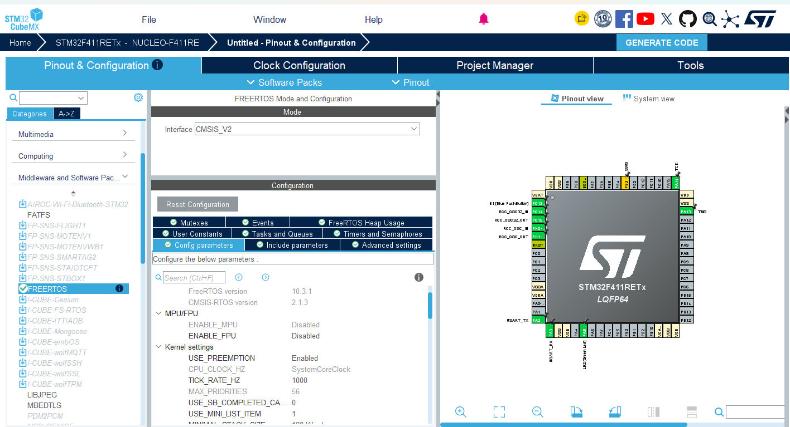
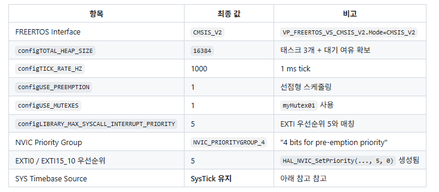
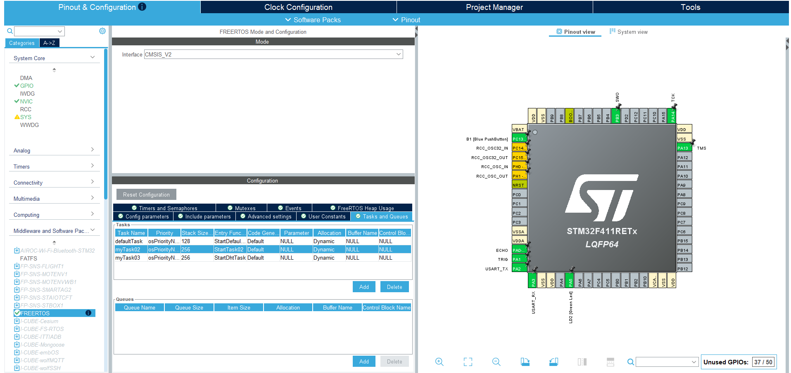
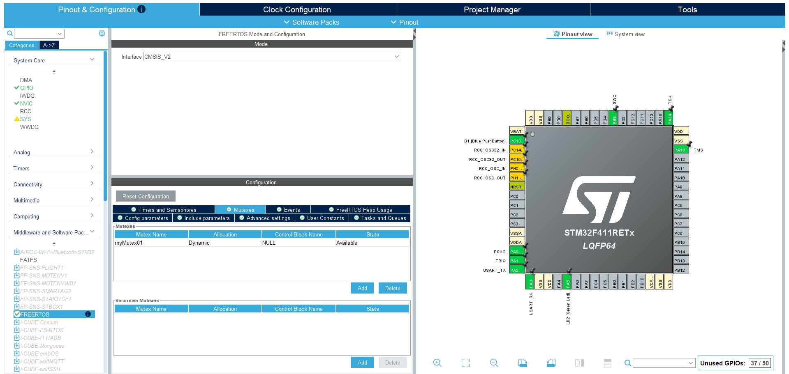
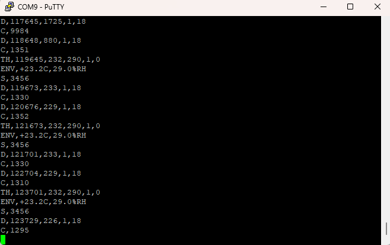
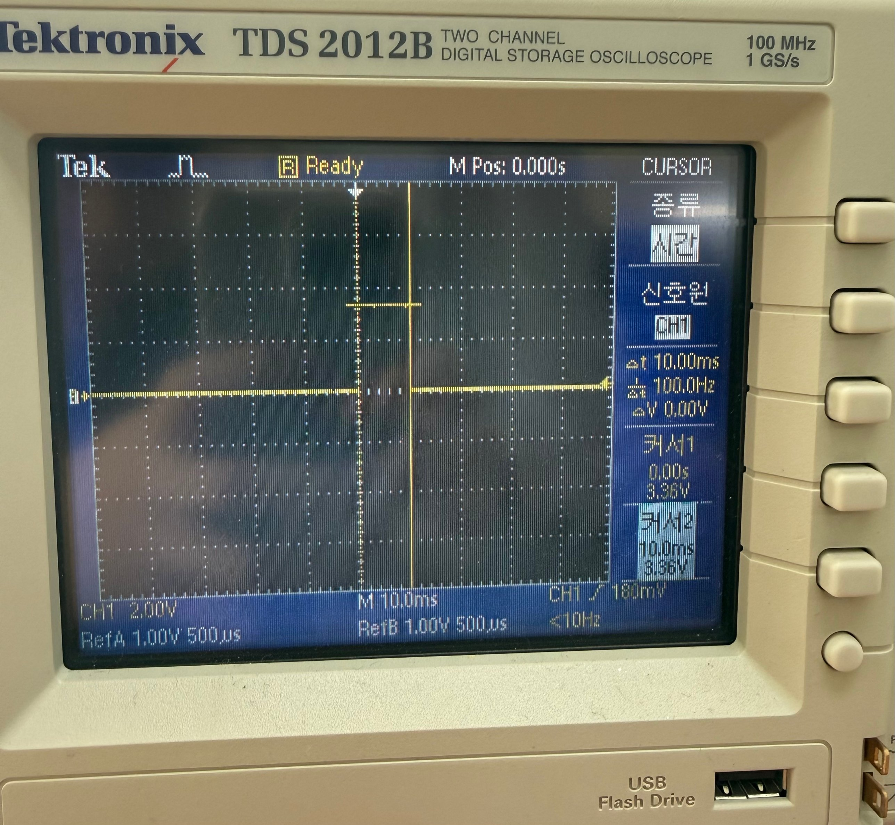

# FreeRTOS

[거리측정.md](거리측정.md)의 초음파 측정과 [온습도.md](온습도.md)의 DHT 온습도 읽기를 **FreeRTOS(CMSIS-RTOS V2)** 태스크로 나누어 동작시킨 실습입니다. STM32CubeMX에서 FreeRTOS를 켜고 커널, 태스크, 뮤텍스를 설정한 뒤 실행 결과를 확인했습니다.

| 항목 | 내용 |
|------|------|
| 보드 | NUCLEO-F411RE (STM32F411RETx) |
| RTOS | FreeRTOS 10.3.1 / CMSIS-RTOS 2.1.3 (Interface: CMSIS_V2) |
| 스케줄링 | 선점형 (Preemption), Tick 1 kHz (1 ms) |
| 태스크 | 3개 (`defaultTask`, `myTask02`, `myTask03`) |
| 뮤텍스 | 1개 (`myMutex01`) |
| 출력 | USART2 (115200 bps), PuTTY로 확인 |

---

## 1. FreeRTOS 활성화

CubeMX의 `Middleware and Software Packs → FREERTOS`에서 Interface를 **CMSIS_V2**로 선택합니다. Kernel settings에서 `USE_PREEMPTION`은 Enabled, `TICK_RATE_HZ`는 1000입니다.

---

## 2. 주요 설정 값

- **힙 크기:** `configTOTAL_HEAP_SIZE`는 16384로, 태스크 3개와 여유 공간을 확보했습니다.
- **스케줄링:** `configTICK_RATE_HZ` 1000(1 ms tick), `configUSE_PREEMPTION` 1(선점형)입니다.
- **뮤텍스:** `configUSE_MUTEXES`를 1로 두고 `myMutex01`을 사용합니다.
- **인터럽트 우선순위:** NVIC Priority Group은 `NVIC_PRIORITYGROUP_4`(4 bits for pre-emption priority)입니다. `configLIBRARY_MAX_SYSCALL_INTERRUPT_PRIORITY`를 5로 두고, ECHO(EXTI0)와 버튼(EXTI15_10) 인터럽트 우선순위도 5로 맞췄습니다. (`HAL_NVIC_SetPriority(..., 5, 0)`)
- **타임베이스:** SYS Timebase Source는 SysTick을 그대로 유지했습니다.

---

## 3. 태스크 (Tasks)

| 태스크 | 스택 | Entry Function | Allocation |
|--------|------|----------------|------------|
| `defaultTask` | 128 | `StartDefaultTask` | Dynamic |
| `myTask02` | 256 | `StartTask02` | Dynamic |
| `myTask03` | 256 | `StartDhtTask` | Dynamic |

`myTask03`은 DHT 온습도 읽기를 담당하는 `StartDhtTask`로 연결했습니다. Queue는 사용하지 않았습니다.

---

## 4. 뮤텍스 (Mutexes)

`myMutex01`을 Dynamic 할당으로 만들었습니다. 여러 태스크가 함께 쓰는 자원을 한 번에 하나의 태스크만 사용하도록 보호하는 용도입니다.

---

## 5. 실행 결과 (PuTTY)

- `D` 줄(거리)은 타임스탬프가 117645 → 118648처럼 약 **1초 간격**으로 출력됩니다.
- `TH` / `ENV` / `S` 줄(온습도, 음속)은 119645 → 121673 → 123701처럼 약 **2초 간격**으로 출력됩니다.
- 온도 23.2 °C, 습도 29.0 %RH에서 적용 음속은 `S,3456` (345.6 m/s)입니다.
- `D` 줄은 `valid=1`로 유효한 거리 값이 나오고 있습니다. (예: `D,119673,233,1,18`)

---

## 6. 오실로스코프 측정

Tektronix TDS 2012B로 측정한 화면입니다. CH1 2.00 V/div, 시간축 10.0 ms/div이고, 커서 간격은 10.00 ms(100.0 Hz)입니다.
