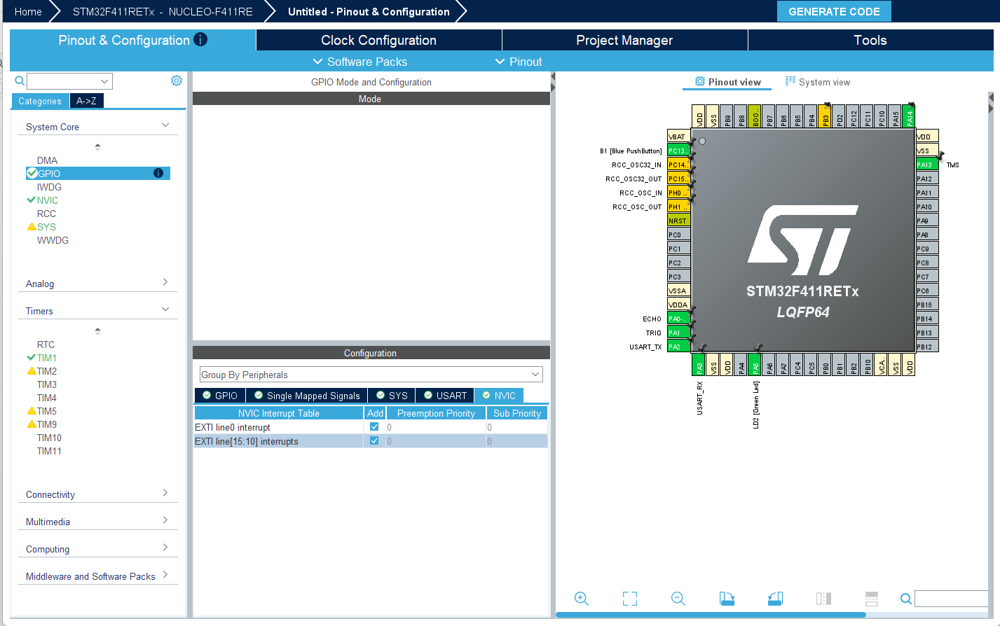
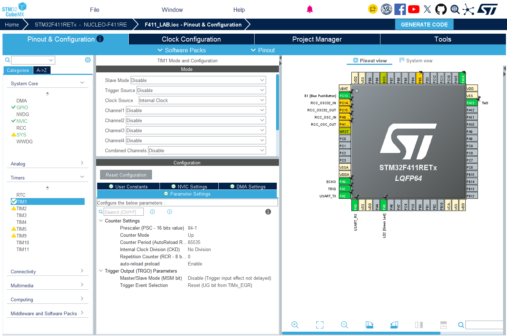
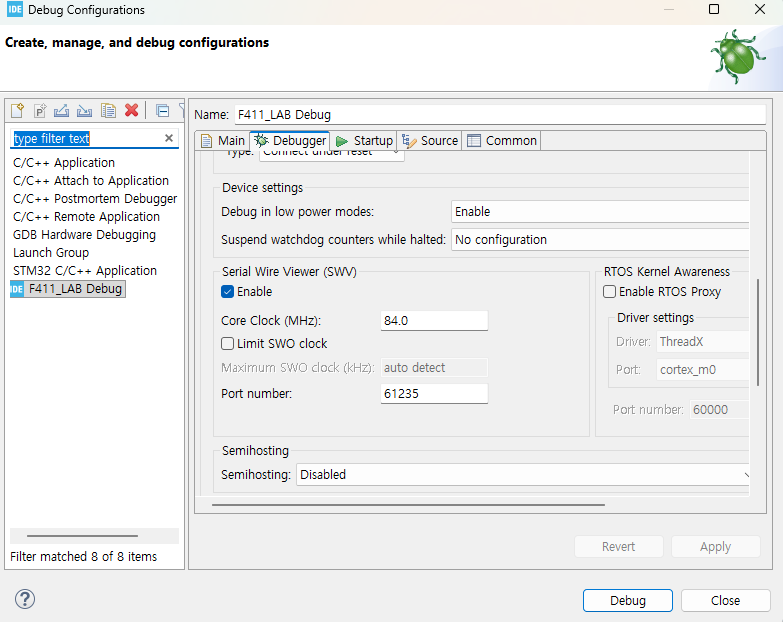
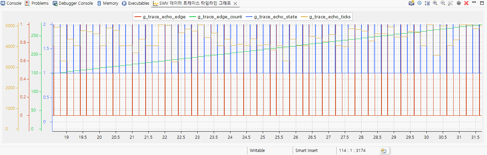

# F411_LAB

NUCLEO-F411RE(STM32F411RE) 보드로 진행한 **F411 실습 프로젝트**입니다. STM32CubeMX로 핀/타이머/인터럽트/UART를 설정하고, STM32CubeIDE(HAL)로 구현·디버깅한 과정을 정리했습니다.

## 1. 개발 환경

| 항목 | 내용 |
|------|------|
| 보드 | NUCLEO-F411RE |
| MCU | STM32F411RETx (LQFP64, Cortex-M4) |
| 도구 | STM32CubeMX, STM32CubeIDE, PuTTY |
| 라이브러리 | STM32 HAL 드라이버 |
| 시스템 클럭 | HSI → PLL, SYSCLK 84 MHz |
| 디버거 | ST-LINK (SWV 사용) |

## 2. 실습에서 사용한 주변장치

| 주변장치 | 핀 | 설정 | 용도 |
|----------|----|------|------|
| GPIO Output | PA1 (TRIG) | GPIO_Output | 트리거 펄스 출력 |
| GPIO EXTI | PA0 (ECHO) | GPIO_EXTI0, Rising/Falling | 에코 에지 검출 |
| GPIO EXTI | PC13 (B1) | GPIO_EXTI13, Falling | 사용자 버튼 |
| GPIO Output | PA5 (LD2) | GPIO_Output | LED (버튼으로 토글) |
| TIM1 | - | Prescaler 84-1, ARR 65535, Internal Clock | 1 µs 단위 카운터 |
| USART2 | PA2 / PA3 | 115200 bps, 8N1 | PC로 결과 출력 |
| NVIC | - | EXTI line0, EXTI line[15:10] | 인터럽트 활성화 |

## 3. CubeMX 설정 과정

### 3-1. PA0 → `GPIO_EXTI0`


### 3-2. PA1 → `GPIO_Output`


### 3-3. NVIC 인터럽트 활성화
`EXTI line0`, `EXTI line[15:10]` 인터럽트를 켭니다.



### 3-4. TIM1 설정
84 MHz / 84 = 1 MHz → 1 tick = 1 µs, Counter Period 65535.



### 3-5. GPIO 에지 검출 모드
PA0을 `External Interrupt Mode with Rising/Falling edge trigger detection`으로 지정합니다.


## 4. 구현 내용 (HC-SR04 초음파 거리 측정)

위 설정을 바탕으로 HC-SR04 초음파 센서 거리 측정을 구현했습니다.

1. 200 ms마다 TRIG(PA1)에 10 µs 펄스를 출력
2. ECHO(PA0)의 상승/하강 에지 인터럽트에서 TIM1 카운터 값을 읽어 펄스 폭(µs) 계산
3. `거리(mm) = 펄스폭(µs) × 343 / 2 / 1000` 으로 변환 (코드: `width_us × 3430 / 20000`)
4. 최근 5개 샘플의 중앙값을 1초마다 UART로 출력
5. 유효 범위(20~4000 mm) 밖이거나 35 ms 내 에코가 없으면 에러로 집계

### 소스 구성

| 파일 | 설명 |
|------|------|
| `Core/Src/main.c` | 초기화, `printf` 리다이렉트, `Sensor_Task()`, EXTI 콜백 |
| `Core/Src/ultrasonic.c`, `Core/Inc/ultrasonic.h` | 초음파 측정 드라이버 |
| `Core/Src/stm32f4xx_it.c` | EXTI 인터럽트 핸들러 |
| `F411_LAB.ioc` | CubeMX 설정 파일 |
| `F411_LAB.img/` | README용 캡처 이미지 |

## 5. 실행 결과 (UART / PuTTY)

115200 bps로 연결하면 1초마다 다음 형식으로 출력됩니다.

```
D,<timestamp_ms>,<distance_mm>,<valid>,<errors>
C,<last_echo_ticks>
```


## 6. SWV 디버깅

`g_trace_*` 변수를 SWV 데이터 트레이스 타임라인 그래프로 관찰했습니다.

| 설명 | 이미지 |
|------|--------|
| SWV 뷰 열기 (`Window → Show View → SWV`) |  |
| Debug Configurations: SWV Enable, Core Clock 84 MHz |  |
| SWV 설정 창 |  |
| 에코 신호 추적 그래프 |  |
| TRIG / ECHO 에지 그래프 |  |

## 7. 빌드 및 실행

1. STM32CubeIDE에서 프로젝트를 Import (또는 `F411_LAB.ioc`를 CubeMX로 열기)
2. Build 후 Debug/Run으로 보드에 다운로드
3. ST-LINK 가상 COM 포트를 PuTTY로 연결 (115200, 8N1)
