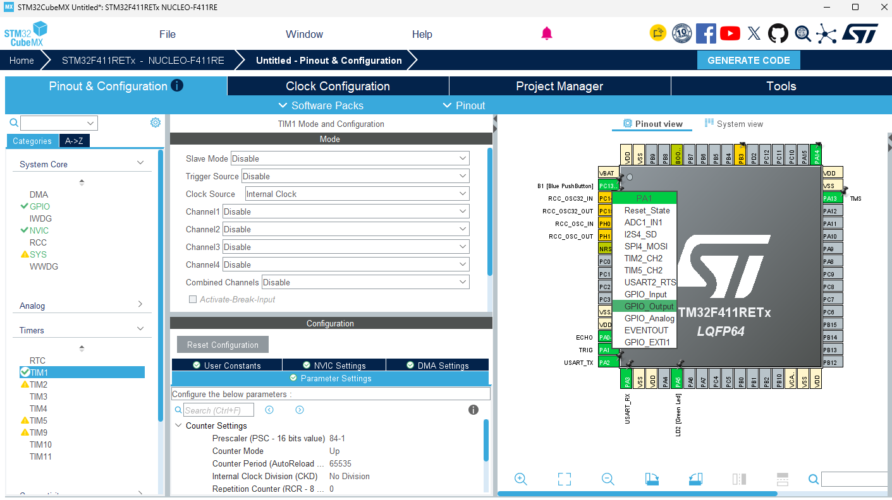
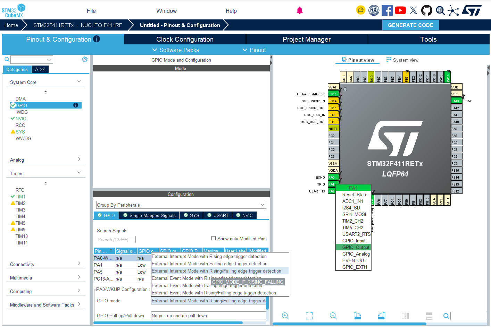
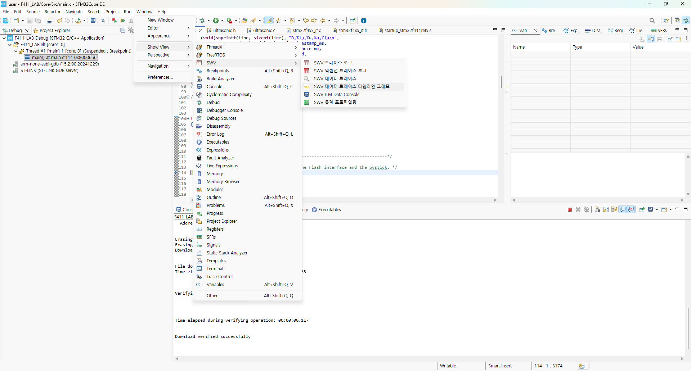
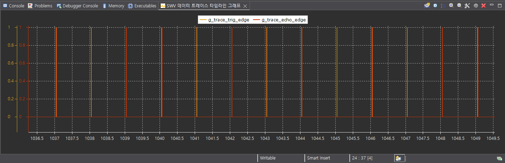

# F411_LAB — NUCLEO-F411RE + HC-SR04 초음파 거리 측정

STM32F411RE(NUCLEO-F411RE) 보드에서 **HC-SR04 초음파 센서**의 ECHO 펄스 폭을 **TIM1 카운터 + 외부 인터럽트(EXTI)** 로 측정하고, 중앙값 필터를 거친 거리 값을 **UART(USART2)** 로 출력하는 실습 프로젝트입니다.

- 보드 / MCU: NUCLEO-F411RE / STM32F411RETx (LQFP64)
- 개발 도구: STM32CubeMX, STM32CubeIDE (HAL 드라이버)
- 시스템 클럭: HSI → PLL, SYSCLK 84 MHz

---

## 1. 핀 연결

| 기능 | 핀 | 모드 | 설명 |
|------|----|------|------|
| TRIG | PA1 | GPIO_Output | 10 µs 트리거 펄스 출력 |
| ECHO | PA0 | GPIO_EXTI0 (Rising/Falling) | 에코 펄스의 상승/하강 에지에서 인터럽트 |
| USART2 TX / RX | PA2 / PA3 | USART2 (115200 8N1) | PC 터미널(PuTTY)로 결과 출력 |
| LD2 (Green LED) | PA5 | GPIO_Output | B1 버튼 인터럽트 시 토글 |
| B1 (Blue PushButton) | PC13 | GPIO_EXTI13 (Falling) | 사용자 버튼 |

---

## 2. CubeMX 설정

### 2-1. ECHO 핀 (PA0) → `GPIO_EXTI0`
PA0을 `GPIO_EXTI0`으로 지정합니다. 타이머는 TIM1을 Internal Clock으로 사용합니다.


### 2-2. TRIG 핀 (PA1) → `GPIO_Output`
PA1을 `GPIO_Output`으로 지정해 트리거 펄스를 출력합니다.



### 2-3. NVIC 인터럽트 활성화
ECHO(PA0)용 `EXTI line0`, 버튼(PC13)용 `EXTI line[15:10]` 인터럽트를 활성화합니다. (Preemption/Sub Priority 모두 0)


### 2-4. TIM1 — 1 µs 카운터
TIM1은 APB2 클럭(84 MHz)을 **Prescaler 84-1** 로 나눠 **1 MHz(1 tick = 1 µs)** 로 동작시키고, Counter Period는 65535(16비트 최대)로 둡니다. 에코 폭을 µs 단위로 바로 읽을 수 있습니다.

| 항목 | 값 |
|------|----|
| Prescaler | 84-1 |
| Counter Mode | Up |
| Counter Period (ARR) | 65535 |
| Clock Division | No Division |
| auto-reload preload | Enable |


### 2-5. GPIO 에지 검출 모드
ECHO 핀은 **External Interrupt Mode with Rising/Falling edge trigger detection** (`GPIO_MODE_IT_RISING_FALLING`)으로 설정합니다. 상승 에지에서 시작 시각, 하강 에지에서 종료 시각을 캡처하기 위함입니다.



---

## 3. 동작 원리

1. **트리거** — 200 ms(5 Hz)마다 TRIG(PA1)을 10 µs 동안 High로 올립니다.
2. **에코 측정** — ECHO(PA0)의 상승 에지에서 TIM1 카운터 값을 저장하고, 하강 에지에서 `현재값 − 시작값` 으로 펄스 폭(µs)을 계산합니다 (`Ultrasonic_OnEchoEdge()`, `HAL_GPIO_EXTI_Callback()`에서 호출).
3. **거리 계산** — `거리(mm) = 펄스폭(µs) × 음속(343 m/s) / 2` (코드에서는 `width_us × 3430 / 20000`).
4. **필터링** — 최근 5개 샘플의 **중앙값(median)** 을 사용하고, 1초(1 Hz)마다 결과를 발행합니다.
5. **유효 범위 / 타임아웃** — 에코 폭 100 ~ 30000 µs, 거리 20 ~ 4000 mm 범위만 유효. 35 ms 안에 에코가 없으면 에러로 집계합니다.
6. **출력** — USART2(115200 bps)로 결과를 전송합니다.

### 소스 구성

| 파일 | 설명 |
|------|------|
| `Core/Src/main.c` | 초기화, `printf` 리다이렉트(`__io_putchar`), `Sensor_Task()`, EXTI 콜백 |
| `Core/Src/ultrasonic.c`, `Core/Inc/ultrasonic.h` | 초음파 드라이버 (트리거, 에코 캡처, 중앙값 필터, 결과 발행) |
| `Core/Src/stm32f4xx_it.c` | `EXTI0_IRQHandler`, `EXTI15_10_IRQHandler` |
| `F411_LAB.ioc` | CubeMX 설정 파일 |

---

## 4. UART 출력 (PuTTY)

COM 포트를 115200 bps로 열면 1초마다 아래 두 줄이 출력됩니다.

```
D,<timestamp_ms>,<distance_mm>,<valid>,<errors>
C,<last_echo_ticks>
```

| 필드 | 의미 |
|------|------|
| `D` 줄 | 타임스탬프(ms), 중앙값 거리(mm), 유효 여부(1=유효), 누적 에러 수 |
| `C` 줄 | 마지막으로 측정된 에코 폭(timer tick = µs) |


> 위 캡처는 `valid=0`, `distance=0`이고 `errors` 값이 1초마다 5씩 증가하는 상태입니다. 즉 매 샘플이 범위 밖이거나 타임아웃으로 처리된 경우입니다. 센서 배선(5V, GND, TRIG/ECHO), ECHO 전압 레벨, 대상까지의 거리를 확인해 보세요.

---

## 5. SWV 디버깅 (STM32CubeIDE)

SWV(Serial Wire Viewer)의 **데이터 트레이스 타임라인 그래프**로 전역 변수(`g_trace_*`)를 실시간으로 관찰해 TRIG/ECHO 타이밍을 확인했습니다.

### 5-1. SWV 뷰 열기
`Window → Show View → SWV → SWV 데이터 트레이스 타임라인 그래프`



### 5-2. 디버그 구성 (SWV Enable)
Debug Configurations → Debugger 탭에서 **Serial Wire Viewer (SWV) → Enable**, Core Clock **84.0 MHz** 로 설정합니다.


### 5-3. SWV 설정 창
코어 클럭 84 MHz, SWO 클럭 2000 kHz, 데이터 트레이스 Comparator에 관찰할 변수를 지정합니다.


### 5-4. 에코 신호 추적
`g_trace_echo_edge`, `g_trace_edge_count`, `g_trace_echo_state`, `g_trace_echo_ticks` 를 함께 그린 그래프입니다.


### 5-5. TRIG / ECHO 에지 비교
`g_trace_trig_edge`와 `g_trace_echo_edge`를 함께 그려 트리거 직후 에코 에지가 발생하는 타이밍을 확인했습니다.



---

## 6. 빌드 및 실행

1. STM32CubeIDE에서 `F411_LAB` 프로젝트를 Import (또는 `F411_LAB.ioc`를 CubeMX로 열기).
2. Build 후 Debug/Run으로 NUCLEO-F411RE에 다운로드.
3. ST-LINK 가상 COM 포트를 PuTTY 등으로 **115200, 8N1** 로 연결.
4. 시작 메시지(`=== F411_TASK_LAB Step 2: Ultrasonic ===`)와 이후 `D,...` / `C,...` 출력을 확인.
