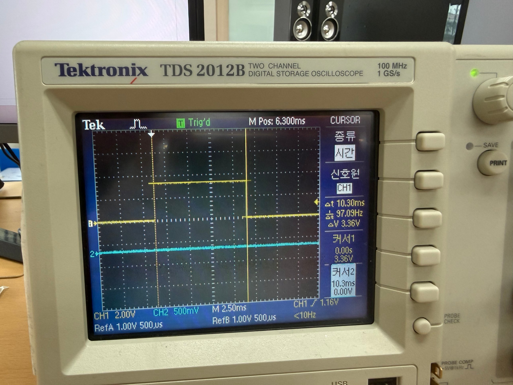
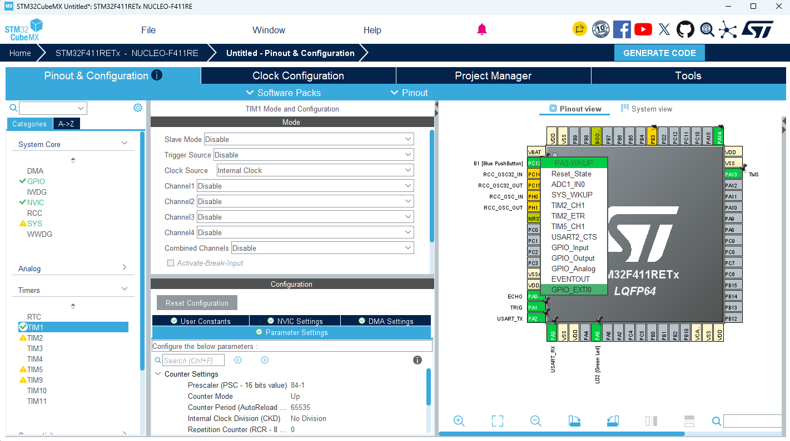
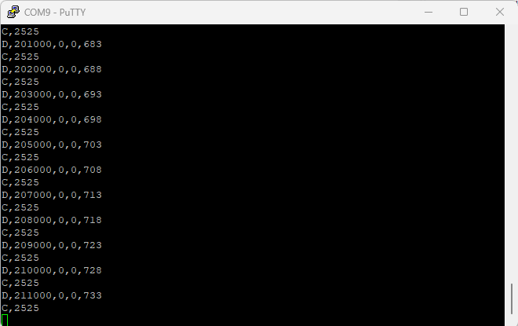
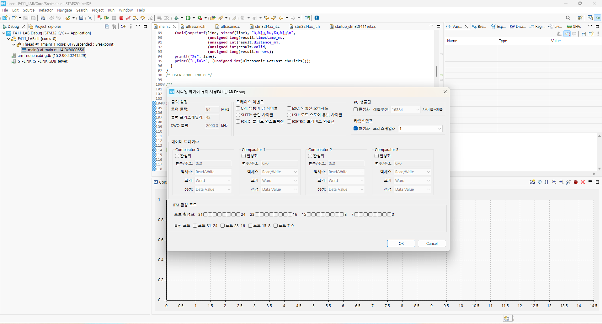
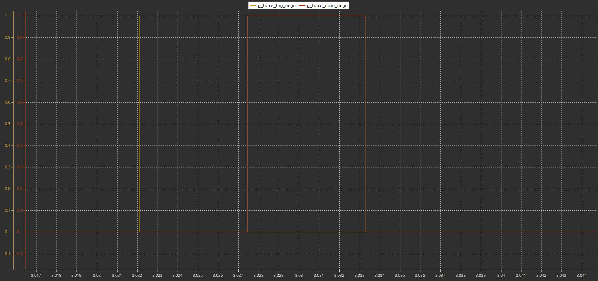

# F411_LAB

**Ultrasonic Oscilloscope 측정**



NUCLEO-F411RE(STM32F411RE) 보드로 진행한 **F411 실습 프로젝트**입니다. STM32CubeMX로 핀/타이머/인터럽트/UART를 설정하고, STM32CubeIDE(HAL)로 구현·디버깅한 과정을 정리했습니다.

## 1. 개발 환경

| 항목 | 내용 |
|------|------|
| 보드 | NUCLEO-F411RE |
| MCU | STM32F411RETx (LQFP64, Cortex-M4) |
| 도구 | STM32CubeMX, STM32CubeIDE, PuTTY |
| 라이브러리 | STM32 HAL 드라이버 |
| 시스템 클럭 | HSI → PLL, SYSCLK 84 MHz |
| 디버거 | ST-LINK (SWV 사용) |

## 2. 실습에서 사용한 주변장치

| 주변장치 | 핀 | 설정 | 용도 |
|----------|----|------|------|
| GPIO Output | PA1 (TRIG) | GPIO_Output | 트리거 펄스 출력 |
| GPIO EXTI | PA0 (ECHO) | GPIO_EXTI0, Rising/Falling | 에코 에지 검출 |
| GPIO EXTI | PC13 (B1) | GPIO_EXTI13, Falling | 사용자 버튼 |
| GPIO Output | PA5 (LD2) | GPIO_Output | LED (버튼으로 토글) |
| TIM1 | - | Prescaler 84-1, ARR 65535, Internal Clock | 1 µs 단위 카운터 |
| USART2 | PA2 / PA3 | 115200 bps, 8N1 | PC로 결과 출력 |
| NVIC | - | EXTI line0, EXTI line[15:10] | 인터럽트 활성화 |

## 3. CubeMX 설정 과정

### 3-1. PA0 → `GPIO_EXTI0`


### 3-2. PA1 → `GPIO_Output`


### 3-3. NVIC 인터럽트 활성화
`EXTI line0`, `EXTI line[15:10]` 인터럽트를 켭니다.


### 3-4. TIM1 설정
84 MHz / 84 = 1 MHz → 1 tick = 1 µs, Counter Period 65535.


### 3-5. GPIO 에지 검출 모드
PA0을 `External Interrupt Mode with Rising/Falling edge trigger detection`으로 지정합니다.


## 4. 구현 내용 (HC-SR04 초음파 거리 측정)

위 설정을 바탕으로 HC-SR04 초음파 센서 거리 측정을 구현했습니다.

1. 200 ms마다 TRIG(PA1)에 10 µs 펄스를 출력
2. ECHO(PA0)의 상승/하강 에지 인터럽트에서 TIM1 카운터 값을 읽어 펄스 폭(µs) 계산
3. `거리(mm) = 펄스폭(µs) × 343 / 2 / 1000` 으로 변환 (코드: `width_us × 3430 / 20000`)
4. 최근 5개 샘플의 중앙값을 1초마다 UART로 출력
5. 유효 범위(20~4000 mm) 밖이거나 35 ms 내 에코가 없으면 에러로 집계

### 소스 구성

| 파일 | 설명 |
|------|------|
| `Core/Src/main.c` | 초기화, `printf` 리다이렉트, `Sensor_Task()`, EXTI 콜백 |
| `Core/Src/ultrasonic.c`, `Core/Inc/ultrasonic.h` | 초음파 측정 드라이버 |
| `Core/Src/stm32f4xx_it.c` | EXTI 인터럽트 핸들러 |
| `F411_LAB.ioc` | CubeMX 설정 파일 |
| `F411_LAB.img/` | README용 캡처 이미지 |

## 5. 실행 결과 (UART / PuTTY)

115200 bps로 연결하면 1초마다 다음 형식으로 출력됩니다.

```
D,<timestamp_ms>,<distance_mm>,<valid>,<errors>
C,<last_echo_ticks>
```



## 6. SWV 디버깅

`g_trace_*` 변수를 SWV 데이터 트레이스 타임라인 그래프로 관찰했습니다.

| 설명 | 이미지 |
|------|--------|
| SWV 뷰 열기 (`Window → Show View → SWV`) |  |
| Debug Configurations: SWV Enable, Core Clock 84 MHz |  |
| SWV 설정 창 |  |
| 에코 신호 추적 그래프 |  |
| TRIG / ECHO 에지 그래프 |  |

## 7. 빌드 및 실행

1. STM32CubeIDE에서 프로젝트를 Import (또는 `F411_LAB.ioc`를 CubeMX로 열기)
2. Build 후 Debug/Run으로 보드에 다운로드
3. ST-LINK 가상 COM 포트를 PuTTY로 연결 (115200, 8N1)

## 8. 소스 코드

### ultrasonic.h

```c
#ifndef ULTRASONIC_H
#define ULTRASONIC_H

#ifdef __cplusplus
extern "C" {
#endif

#include <stdint.h>
#include "stm32f4xx_hal.h"

typedef struct
{
  uint32_t timestamp_ms;
  uint32_t errors;
  uint16_t distance_ref_mm;
  uint16_t distance_mm;
  uint8_t valid;
} Ultrasonic_Result;

extern volatile uint16_t g_trace_echo_ticks;
extern volatile uint8_t g_trace_echo_edge;
extern volatile uint8_t g_trace_echo_state;
extern volatile uint32_t g_trace_edge_count;
extern volatile uint8_t g_trace_trig_edge;


void Ultrasonic_Init(void);
void Ultrasonic_Task(void);
uint8_t Ultrasonic_GetResult(Ultrasonic_Result *result);
uint16_t Ultrasonic_GetLastEchoTicks(void);
uint8_t Ultrasonic_IsIdle(void);
void Ultrasonic_SetSoundSpeedX10(uint16_t speed_x10);
void Ultrasonic_OnEchoEdge(void);

#ifdef __cplusplus
}
#endif

#endif
```

### ultrasonic.c

```c
#include "ultrasonic.h"
#include "main.h"

extern TIM_HandleTypeDef htim1;

volatile uint16_t g_trace_echo_ticks;
volatile uint8_t g_trace_echo_edge;
volatile uint8_t g_trace_echo_state;
volatile uint32_t g_trace_edge_count;
volatile uint8_t g_trace_trig_edge;

#define US_SAMPLE_PERIOD_MS 1000U
#define US_PUBLISH_PERIOD_MS 1000U
#define US_ECHO_TIMEOUT_MS 35U
#define US_TRIG_PULSE_US 10U
#define US_TIMER_TICKS_PER_US 1U
#define US_MIN_ECHO_TICKS (100U * US_TIMER_TICKS_PER_US)
#define US_MAX_ECHO_TICKS (30000U * US_TIMER_TICKS_PER_US)
#define US_MIN_DISTANCE_MM 20U
#define US_MAX_DISTANCE_MM 4000U
#define US_FILTER_SIZE 5U
#define US_REFERENCE_SOUND_SPEED_X10 3430U
#define US_DEFAULT_SOUND_SPEED_X10 US_REFERENCE_SOUND_SPEED_X10
#define US_MIN_SOUND_SPEED_X10 2500U
#define US_MAX_SOUND_SPEED_X10 4000U

typedef enum
{
  US_STATE_IDLE = 0,
  US_STATE_WAIT_ECHO
} Ultrasonic_State;

static TIM_HandleTypeDef *s_htim;
static volatile Ultrasonic_State s_state;
static uint32_t s_lastSampleTick;
static uint32_t s_lastPublishTick;
static uint32_t s_echoStartTick;
static uint16_t s_echoStartCnt;
static volatile uint16_t s_echoWidthTicks;
static volatile uint8_t s_echoRising;
static volatile uint8_t s_echoDone;
static uint16_t s_samplesRef[US_FILTER_SIZE];
static uint16_t s_samplesCorr[US_FILTER_SIZE];
static uint8_t s_sampleCount;
static uint8_t s_sampleIndex;
static uint32_t s_errorCount;
static uint16_t s_soundSpeedX10;
static Ultrasonic_Result s_result;
static volatile uint8_t s_resultReady;

static uint16_t US_GetCounter(void);
static void US_StoreSample(uint32_t width_ticks);
static uint16_t US_Median(const uint16_t *samples);
static void US_Publish(uint32_t now);

static uint16_t US_GetCounter(void)
{
  return (uint16_t)__HAL_TIM_GET_COUNTER(s_htim);
}

void Ultrasonic_Init(void)
{
  s_htim = &htim1;
  HAL_GPIO_WritePin(TRIG_GPIO_Port, TRIG_Pin, GPIO_PIN_RESET);

  if (HAL_TIM_Base_Start(s_htim) != HAL_OK)
  {
    Error_Handler();
  }

  s_state = US_STATE_IDLE;
  s_lastSampleTick = HAL_GetTick();
  s_lastPublishTick = s_lastSampleTick;
  s_echoStartTick = 0U;
  s_echoStartCnt = 0U;
  s_echoWidthTicks = 0U;
  s_echoRising = 0U;
  s_echoDone = 0U;
  s_sampleCount = 0U;
  s_sampleIndex = 0U;
  s_errorCount = 0U;
  s_soundSpeedX10 = US_DEFAULT_SOUND_SPEED_X10;
  s_resultReady = 0U;
  s_result.timestamp_ms = 0U;
  s_result.distance_ref_mm = 0U;
  s_result.distance_mm = 0U;
  s_result.valid = 0U;
  s_result.errors = 0U;
  g_trace_echo_ticks = 0U;
  g_trace_echo_edge = 0U;
  g_trace_echo_state = 0U;
  g_trace_edge_count = 0U;
  g_trace_trig_edge = 0U;
}

void Ultrasonic_Task(void)
{
  uint32_t now;
  uint16_t trigStartCnt;

  if (s_htim == NULL)
  {
    return;
  }

  now = HAL_GetTick();

  switch (s_state)
  {
    case US_STATE_IDLE:
      if ((now - s_lastSampleTick) >= US_SAMPLE_PERIOD_MS)
      {
        s_lastSampleTick = now;
        s_echoRising = 0U;
        s_echoDone = 0U;

        trigStartCnt = US_GetCounter();
        HAL_GPIO_WritePin(TRIG_GPIO_Port, TRIG_Pin, GPIO_PIN_SET);
        g_trace_trig_edge = 1U;
        while ((uint16_t)(US_GetCounter() - trigStartCnt) < US_TRIG_PULSE_US)
        {
        }
        HAL_GPIO_WritePin(TRIG_GPIO_Port, TRIG_Pin, GPIO_PIN_RESET);
        g_trace_trig_edge = 0U;

        s_echoStartTick = now;
        s_state = US_STATE_WAIT_ECHO;
        g_trace_echo_state = 2U;
      }
      break;

    case US_STATE_WAIT_ECHO:
      if (s_echoDone != 0U)
      {
        if (s_echoDone == 1U)
        {
          US_StoreSample(s_echoWidthTicks);
        }
        else
        {
          s_errorCount++;
        }
        s_echoDone = 0U;
        s_state = US_STATE_IDLE;
      }
      else if ((now - s_echoStartTick) >= US_ECHO_TIMEOUT_MS)
      {
        s_errorCount++;
        s_state = US_STATE_IDLE;
        g_trace_echo_edge = 0U;
        g_trace_echo_state = 0U;
      }
      break;

    default:
      s_state = US_STATE_IDLE;
      break;
  }

  if ((now - s_lastPublishTick) >= US_PUBLISH_PERIOD_MS)
  {
    s_lastPublishTick = now;
    US_Publish(now);
  }
}

uint8_t Ultrasonic_GetResult(Ultrasonic_Result *result)
{
  if ((result == NULL) || (s_resultReady == 0U))
  {
    return 0U;
  }

  *result = s_result;
  s_resultReady = 0U;
  return 1U;
}

uint8_t Ultrasonic_IsIdle(void)
{
  return (s_state == US_STATE_IDLE) ? 1U : 0U;
}

void Ultrasonic_SetSoundSpeedX10(uint16_t speed_x10)
{
  if ((speed_x10 >= US_MIN_SOUND_SPEED_X10) && (speed_x10 <= US_MAX_SOUND_SPEED_X10))
  {
    s_soundSpeedX10 = speed_x10;
  }
}

uint16_t Ultrasonic_GetLastEchoTicks(void)
{
  return s_echoWidthTicks;
}

void Ultrasonic_OnEchoEdge(void)
{
  uint16_t now;
  uint16_t width;

  if (s_htim == NULL)
  {
    return;
  }

  now = US_GetCounter();

  if (HAL_GPIO_ReadPin(ECHO_GPIO_Port, ECHO_Pin) == GPIO_PIN_SET)
  {
    if ((s_state == US_STATE_WAIT_ECHO) && (s_echoRising == 0U))
    {
      s_echoStartCnt = now;
      s_echoRising = 1U;
      g_trace_echo_edge = 1U;
      g_trace_echo_state = 1U;
      g_trace_edge_count++;
    }
  }
  else if (s_echoRising != 0U)
  {
    width = (uint16_t)(now - s_echoStartCnt);
    s_echoRising = 0U;
    s_echoWidthTicks = width;
    g_trace_echo_ticks = width;
    g_trace_echo_edge = 0U;
    g_trace_echo_state = 0U;
    g_trace_edge_count++;

    if ((width >= US_MIN_ECHO_TICKS) && (width <= US_MAX_ECHO_TICKS))
    {
      s_echoDone = 1U;
    }
    else
    {
      s_echoDone = 2U;
    }
  }
}

static void US_StoreSample(uint32_t width_ticks)
{
  uint32_t width_us = width_ticks / US_TIMER_TICKS_PER_US;
  uint32_t distance_ref_mm = (width_us * US_REFERENCE_SOUND_SPEED_X10) / 20000U;
  uint32_t distance_mm = (width_us * s_soundSpeedX10) / 20000U;

  if ((distance_mm >= US_MIN_DISTANCE_MM) && (distance_mm <= US_MAX_DISTANCE_MM))
  {
    s_samplesRef[s_sampleIndex] = (uint16_t)distance_ref_mm;
    s_samplesCorr[s_sampleIndex] = (uint16_t)distance_mm;
    s_sampleIndex = (uint8_t)((s_sampleIndex + 1U) % US_FILTER_SIZE);
    if (s_sampleCount < US_FILTER_SIZE)
    {
      s_sampleCount++;
    }
  }
  else
  {
    s_errorCount++;
  }
}

static uint16_t US_Median(const uint16_t *samples)
{
  uint16_t sorted[US_FILTER_SIZE];
  uint8_t i;
  uint8_t j;

  for (i = 0U; i < s_sampleCount; i++)
  {
    sorted[i] = samples[i];
  }

  for (i = 0U; (uint8_t)(i + 1U) < s_sampleCount; i++)
  {
    for (j = (uint8_t)(i + 1U); j < s_sampleCount; j++)
    {
      if (sorted[j] < sorted[i])
      {
        uint16_t temp = sorted[i];
        sorted[i] = sorted[j];
        sorted[j] = temp;
      }
    }
  }

  return sorted[s_sampleCount / 2U];
}

static void US_Publish(uint32_t now)
{
  s_result.timestamp_ms = now;

  if (s_sampleCount > 0U)
  {
    s_result.distance_ref_mm = US_Median(s_samplesRef);
    s_result.distance_mm = US_Median(s_samplesCorr);
    s_result.valid = 1U;
  }
  else
  {
    s_result.distance_ref_mm = 0U;
    s_result.distance_mm = 0U;
    s_result.valid = 0U;
  }

  s_result.errors = s_errorCount;
  s_resultReady = 1U;

  s_sampleCount = 0U;
  s_sampleIndex = 0U;
}
```

## 9. TRIG / ECHO 에지 측정 결과

`g_trace_trig_edge`(노랑)와 `g_trace_echo_edge`(빨강)를 함께 그린 그래프입니다.


