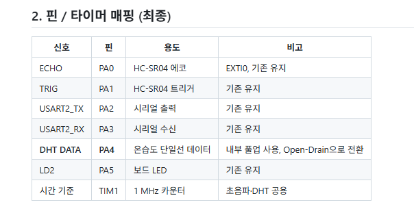
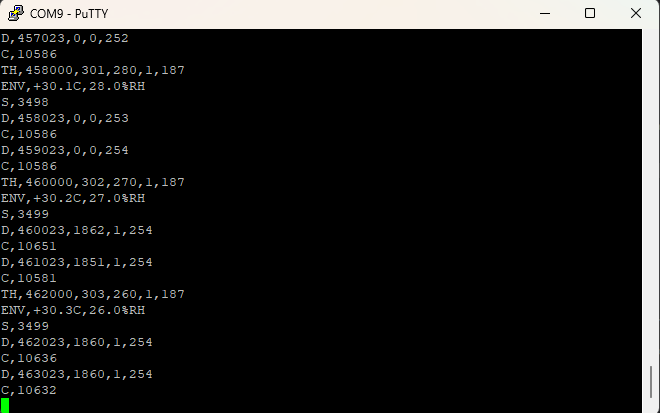

# 온습도 (DHT) 센서 추가와 음속 보정

초음파 거리 측정(HC-SR04) 프로젝트에 **DHT 온습도 센서**를 추가하고, 측정한 온도·습도로 **음속을 보정**해 거리 값의 정확도를 높인 실습입니다. 초음파 측정 부분은 [거리측정.md](거리측정.md)를 기준으로 그대로 유지했습니다.

| 항목 | 내용 |
|------|------|
| 보드 | NUCLEO-F411RE (STM32F411RETx) |
| 기준 코드 | HC-SR04 초음파 거리 측정 코드 (기존 유지) |
| 추가 센서 | DHT 온습도 센서 (단일선 통신, DATA = PA4) |
| 시간 기준 | TIM1 1 MHz 카운터를 초음파와 DHT가 함께 사용 |
| 추가 기능 | 온도·습도로 음속을 계산해 거리 계산에 반영 |
| 출력 | USART2 (115200 bps), PuTTY로 확인 |

---

## 1. 회로 구성

NUCLEO-F411RE에 HC-SR04와 DHT 온습도 센서를 함께 연결했습니다. 전원과 시리얼 출력은 ST-LINK USB 한 개로 사용합니다.

---

## 2. 핀 / 타이머 매핑

사용한 핀은 아래 NUCLEO-F411RE 핀맵에서 확인할 수 있습니다. ECHO(PA0), TRIG(PA1), DHT DATA(PA4)는 Arduino 헤더의 A0, A1, A2에 해당합니다.

- 기존 초음파 핀(PA0, PA1)과 USART2(PA2, PA3), LD2(PA5)는 **그대로 유지**했습니다.
- 새로 추가한 핀은 **PA4(DHT DATA)** 하나입니다. 내부 풀업을 사용하고, 통신 시 **Open-Drain** 으로 전환합니다.
- DHT용 타이머를 따로 만들지 않고, 초음파에서 쓰던 **TIM1(1 MHz)** 을 공용으로 사용합니다. 1 tick = 1 µs라서 DHT 신호의 펄스 폭을 µs 단위로 바로 읽을 수 있습니다.

---

## 3. 변경 파일 목록

| 파일 | 변경 내용 |
|------|-----------|
| `Core/Inc/dht.h` | 신규 추가 (`Dht_Result` / `Dht_Init` / `Dht_Task` / `Dht_GetResult`) |
| `Core/Src/dht.c` | 신규 추가, TIM1 기준으로 메인에 맞게 수정 |
| `Core/Src/main.c` | DHT 초기화·태스크 호출, 음속 보정, 시리얼 출력 추가 |
| `Debug/Core/Src/subdir.mk` | `dht.c`를 빌드 소스/오브젝트/의존성/clean에 추가 |
| `Debug/objects.list` | 링커 입력에 `./Core/Src/dht.o` 추가 |

---

## 4. 음속 보정 원리

초음파 거리는 `거리 = 에코 펄스 폭 × 음속 / 2` 로 계산하기 때문에, 음속이 달라지면 거리 값도 달라집니다. 음속은 공기의 온도(와 습도)에 따라 변하므로, DHT로 측정한 값으로 음속을 갱신하면 거리 오차를 줄일 수 있습니다.

초음파 드라이버(`ultrasonic.c`)에는 이를 위한 구조가 이미 들어 있습니다.

| 항목 | 내용 |
|------|------|
| 기준 음속 | 343.0 m/s (`US_REFERENCE_SOUND_SPEED_X10 = 3430`), 보정 전 값 `distance_ref_mm` 계산에 사용 |
| 보정 음속 | `Ultrasonic_SetSoundSpeedX10()`으로 설정, `distance_mm` 계산에 사용 |
| 유효 범위 | 250.0 ~ 400.0 m/s 밖의 값은 무시 (`2500 ~ 4000`) |
| 단위 | 음속을 10배한 정수 (예: 3498 = 349.8 m/s) |

`main.c`에서 DHT 결과가 갱신될 때마다 온도·습도로 음속을 계산해 `Ultrasonic_SetSoundSpeedX10()`에 넘깁니다.

---

## 5. 시리얼 출력 형식 (115200 bps)

| 접두어 | 주기 | 내용 |
|--------|------|------|
| `D` | 1초 | 거리 (`D,타임스탬프(ms),거리(mm),유효 여부,에러 수`) |
| `C` | 1초 | 마지막 에코 폭 (timer tick = µs) |
| `TH` | 2초 | DHT 원시값 (`TH,타임스탬프(ms),온도×10,습도×10,유효 여부,에러 수`) |
| `ENV` | 2초 | 읽기 쉬운 온습도 (`ENV,+30.1C,28.0%RH`) |
| `S` | 2초 | 현재 적용 중인 음속 (×10, 예: `S,3498` = 349.8 m/s) |

---

## 6. 실행 결과 (PuTTY)

- `TH` / `ENV` / `S` 줄은 타임스탬프가 458000 → 460000 → 462000으로 **2초 간격**으로 출력됩니다.
- 온도가 30.1 °C → 30.2 °C → 30.3 °C로 오르는 동안 적용 음속이 `S,3498` → `S,3499`로 함께 바뀝니다.
- 앞쪽 `D` 줄은 `valid=0`, 거리 0으로 유효한 측정이 없던 상태이고, 뒤쪽에서는 `D,460023,1862,1,254`처럼 `valid=1`이 되어 약 1860 mm 거리가 출력됩니다.

---

## 7. SWV 그래프 (TRIG / ECHO / DHT 에지)

`g_trace_trig_edge`(노랑), `g_trace_echo_edge`(빨강), `g_trace_dht_edge`(파랑)를 함께 그려, 초음파 측정과 DHT 통신이 같은 시간대에 겹치지 않고 차례로 일어나는지 확인했습니다.

